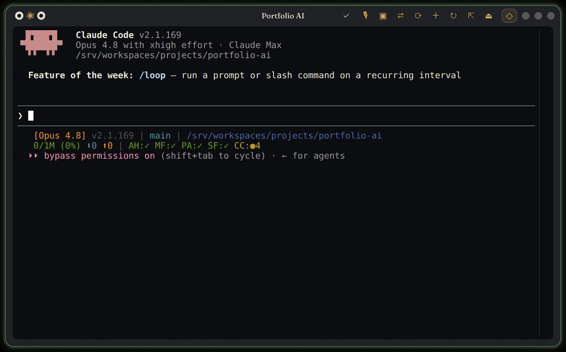

# Aico

Aico is a Linux desktop companion for people working with terminal AI tools. Floating Electron widgets show persistent tmux sessions owned by [Tether](https://github.com/elias-leslie/tether), the per-user session daemon, and let users send selected browser or desktop context into a running agent without leaving their work.



## What it does

- Hosts Claude Code, Codex, Antigravity, Pi, and shells in movable terminal widgets.
- Remembers each window's position and size per session; closing a window never ends the session, and End asks Tether to retire it.
- Lists every Tether session, including ones started from A-Term, the CLI or a SummitFlow root, and opens any of them in a window.
- Offers a command palette, workspace picker, scrollback, and browser selection capture.
- Can animate the window title bar with small optional arcade-style scenes.

## Current scope

Aico targets a single-user Linux desktop. X11 is the best-supported path for global shortcuts; Wayland has limitations. The optional MV3 extension is loaded unpacked for development. macOS, Windows, and `.deb` packaging are not implemented.

## Getting started

Install from source; there is no packaged build. The old AppImages on the [Releases page](https://github.com/elias-leslie/aico/releases) (v0.1.0 and v0.1.1, June 2026) predate the move to Tether, manage tmux sessions themselves and are unsupported.

```bash
git clone https://github.com/elias-leslie/aico.git
cd aico
# Install and start Tether first: in its checkout, npm ci && scripts/install.sh --start default
scripts/aico-install.sh
scripts/aico-launch.sh
```

The installer refuses to continue until `tether --json version` reports API v1 or later, then installs the `aico-shell.service` user unit for this checkout. Electron's sandbox needs user namespaces. When the kernel restricts them, the installer offers an AppArmor profile. Only when namespaces stay unavailable (no profile installed, or the kernel turns them off) does it offer Electron's setuid `chrome-sandbox` helper. It prints these `sudo` steps and runs them only after an interactive yes or with `AICO_INSTALL_PRIVILEGED=1`. Configuration comes from environment variables, not a `.env` file.

Source builds need Node.js 22+, npm, Python 3.13+, and uv. The [project guide](docs/project-guide.md) has the installation details.

## Runtime, data, and integrations

Tether owns sessions: tmux servers, agent launch and admission, End, roots, context hooks, and the legacy `/run/user/<uid>/aico/{control,gui-control}.sock` sockets that `st aico` and SummitFlow use. Its host prerequisites (systemd user manager, cgroup v2, lingering) are checked by Tether's own installer. Aico finds it at `$TETHER_SOCKET`, else `$XDG_RUNTIME_DIR/tether/${TETHER_INSTANCE:-default}/control.sock`. When Tether is down, open windows keep their attached terminals and new actions report that session control is unavailable.

Aico listens on `127.0.0.1:8005` for captures from the browser extension and `st selection send`, refuses other browser origins, and stores none of them: a capture is typed at the last-focused session's prompt or refused. Session events (push results, retired sessions) go to the journal as ids-only `[aico:event]` lines. Aico's own `aico.db` holds only window views (geometry, open state, a local name override) and settings, keyed by session ID. AI provider credentials belong to each CLI. Missing ST capture tooling leaves core widgets working. A-Term is another Tether client; its sessions appear in Aico's session list.

Agent handoffs (`show.requested`, Tether commit `c4741f2` or later) are accepted only from `TETHER_AGENT_SOCKET` (default `/run/tether/agent/default/control.sock`). A notification offers **Show file** or displays the URL with **Copy**. Files are copied on click into `$TETHER_EXCHANGE_ROOT/owner/shown/<id>-<name>`; the root defaults to `/srv/workspaces/exchange`. Previews show raster images or escaped text; other files are revealed in the file manager. URLs are copied without opening a browser.

Before deployment, provision the exchange root and the agent's writable `agent/` subtree. Aico can create `owner/` when the existing exchange root belongs to the owner and is writable only by the owner; otherwise provision `owner/` with owner ownership beforehand. Owner directories must have no group or other write permissions; new directories use `0755` and copies use `0644`. Set the same `TETHER_EXCHANGE_ROOT` for Tether and Aico. Capture packages are produced by external `st ui grab` tooling, so their paths and Aico's `[capture: ...]` references are unchanged here.

## Development and verification

```bash
npm ci
npm run check
```

The npm gate runs lint, type checks, the TypeScript tests of the desktop, Tether and web workspaces, and the build. Session lifecycle is verified in the Tether repo. Avoid broad process-name cleanup. The author also runs these checks through his workspace tool (`st check`).

## Documentation

- [Project guide](docs/project-guide.md) for features, configuration, APIs, and limitations.
- [Source installation](docs/INSTALL.md) and [browser extension](extension/README.md).
- [Glossary](docs/glossary.md) and [root control](docs/root-control.md) (the contract itself lives in Tether).
- [History](docs/history/README.md): the Tether cutover runbook, Tether API gaps and the July 2026 assessment; the [process incident/recovery report](docs/INCIDENT-2026-07-PROCESS-ESCAPES.md) (lifecycle now lives in Tether).
- [Security](SECURITY.md), [Apache 2.0 license](LICENSE), [notice](NOTICE), and [font licenses](assets/fonts/README.md).
